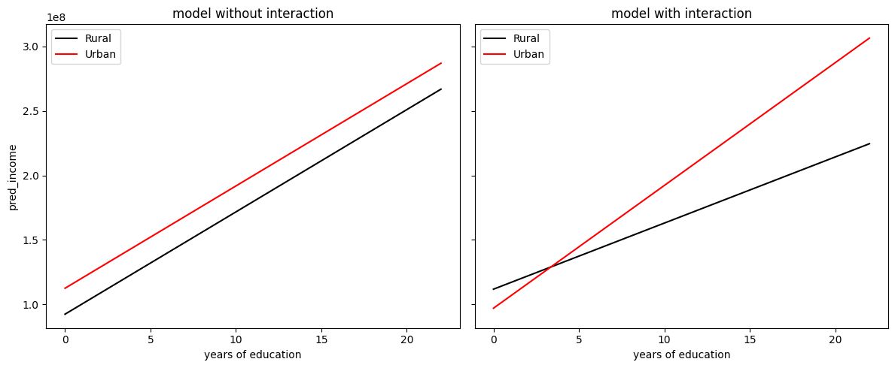

# Education, Income, and Household Welfare in Iran

This group project at Sharif University of Technology uses Iran's Household Budget Survey to study how education relates to household-head income and household welfare. I worked on the income regressions, comparisons across urban and rural areas, genders, and provinces, and a PCA-based welfare index. My analysis is in [ali.ipynb](notebooks/ali.ipynb) and [ali2.ipynb](notebooks/ali2.ipynb).

## Analysis

I used years of schooling to measure education and fitted OLS models with interaction terms to compare education slopes across groups. The welfare index combines price-adjusted income and expenditure per equivalent household member with food and housing expenditure shares.

The main analyses cover survey years 1393–1402 in the Solar Hijri calendar. Year ranges vary across analyses, and some income cells also attempt to load 1403 data.



*Fitted annual household-head income by education and urban or rural residence in 1395, in rial.*

## Selected results

- In the 1395 income model, an additional year of schooling was associated with about **5.12 million rial** higher annual head income in rural areas and **9.51 million rial** in urban areas. Allowing separate slopes raised the model's in-sample R² from **0.083 to 0.088**.
- In the 1394 welfare model, the estimated increase per additional year of schooling was **0.0455 index units** in rural areas and **0.0656** in urban areas. The model's R² was **0.111**.
- In the 1393 comparison across five provinces, the estimated education slopes were positive in all five, ranging from **0.00267** in Qom to **0.00730** in Sistan and Baluchestan.

The models estimate associations using unweighted survey data. The welfare index is standardized separately each year and measures relative welfare within that year. See the model summaries in [ali2.ipynb](notebooks/ali2.ipynb).

## Running the notebooks

The recorded environment uses Python 3.10.2 and HBSIR 0.6.3. Install the dependencies and open JupyterLab:

```bash
python -m pip install -r requirements.txt
python -m jupyter lab
```

Start with the single-year 1395 cells in `notebooks/ali2.ipynb`. The notebooks load survey data through HBSIR. See the [execution notes](docs/REPRODUCIBILITY.md) for data access and known issues.

## Project materials

- [Group report](docs/report-fa.pdf), [presentation](docs/presentation-fa.pdf), and [welfare-index appendix](docs/welfare-index-appendix-fa.pdf), all in Persian
- [Team contributions](docs/CONTRIBUTIONS.md)
- [Team notebooks](archive/team-notebooks/)
